# Stack Overflow After ChatGPT: A Large-Scale Analysis of Code Quality and Community Structure

## Live Resources

- **Interactive dashboard:** [https://cqi-dashboard.onrender.com/frontend/index.html](https://cqi-dashboard.onrender.com/frontend/index.html)

* Need time to initialize if you first open this link

- **Deployment repo:** [YanjingAveryLi/cqi-dashboard](https://github.com/YanjingAveryLi/cqi-dashboard)

## Research Problem

Stack Overflow has been the internet's most important public programming knowledge base since its founding in 2008. When ChatGPT was publicly released in November 2022, the platform's monthly question volume dropped sharply, falling from roughly 87,000 questions per month at its peak to fewer than 50,000 by the end of 2024, a level last seen in the platform's earliest years. Existing research and press coverage have documented this volume collapse, but they have not answered the more consequential structural question: *which questions left, and what happened to the quality of those that remained?*

This matters for a fundamental reason. Stack Overflow is not merely a Q&A website, but a public knowledge infrastructure that students, professionals, and software teams depend on worldwide. If AI diverts a narrow slice of low-effort questions while preserving the platform's core knowledge-generating function, that is a benign transition. But if the platform is quietly becoming inhospitable to learners and novice users, the long-run consequences for technical education and open knowledge access are significant and deserve systematic study.

We investigate this question through two competing hypotheses. The **quality-improvement hypothesis** holds that ChatGPT has filtered out the large volume of basic, repetitive, easily-answered questions that previously dominated the platform. Under this view, the posts that remain are harder, more original, and more valuable, and the apparent contraction actually represents a concentration of the platform's knowledge-generating function. The **composition-shift hypothesis** holds that the apparent quality improvement is an artifact of who left: novice users, who post lower-quality questions on average, have been disproportionately absorbed by AI tools, while expert users remain. The platform is not improving; it is becoming elitist, and the public knowledge commons is quietly shrinking for those who need it most.

Distinguishing between these two hypotheses requires analyzing millions of posts across a fifteen-year time window, segmented by user experience level and topic category, with a causal identification strategy that isolates the ChatGPT cutoff from underlying trends.

## Why Scalable Computing Is Essential

The Stack Overflow data archive covers over 60 million posts. Even restricting to Python questions, i.e., the language most directly affected by AI coding tools, the dataset spans more than 2.6 million posts across monthly partitions from 2008 to 2024. Computing meaningful code quality metrics requires parsing raw HTML post bodies, running static analysis tools (cyclomatic complexity via `radon`, Halstead volume, AST parseability), and joining post data with user reputation records to assign experience tiers. These operations are computationally prohibitive on a single machine at this scale.

Beyond the raw ETL, the analysis pipeline involves distributed filtering and aggregation across month windows, experience tiers, and tag categories; regression discontinuity estimation across fifteen tier-category combinations; supervised ML model training on nearly 1.25 million labeled examples; and KMeans clustering on the full post corpus. Each of these tasks requires distributed computing infrastructure to run in a reasonable time frame. A pandas-only workflow would be fragile for full-scale runs and unable to support the repeated smoke/full execution cycles needed to validate results before committing to expensive cluster time. We used Apache Spark on AWS EMR for large-scale ETL, feature construction, and ML, and Dask for distributed post-processing and visualization.

## Team Contributions

**Qiuyi** was responsible for the data ingestion, ETL pipeline, and CQI feature construction infrastructure. **Yanjing** was responsible for exploratory data analysis, regression discontinuity estimation, machine learning, visualization, and the deployed API and dashboard.

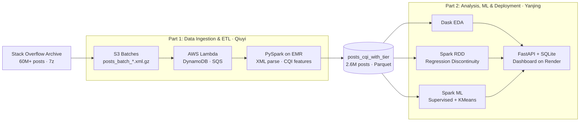

## Part 1: Data Ingestion and ETL Pipeline (Qiuyi)

**Code:** [`scripts/data_ingestion_&_ETL/`](scripts/data_ingestion_&_ETL/)  
**Outputs:** [`outputs/data_ingestion_&_ETL/`](outputs/data_ingestion_&_ETL/)

The raw Stack Overflow data is distributed as a 7z-compressed XML archive. Qiuyi designed and implemented a three-phase automated ingestion pipeline to convert this archive into analysis-ready partitioned Parquet.

**Phase 1: Streaming ingest to S3.** [`stream_posts_to_s3_batches.sh`](scripts/data_ingestion_&_ETL/stream_posts_to_s3_batches.sh) streams the `Posts.xml` file out of the compressed archive using `7za`, pipes each XML row through `awk` to filter post records, and uses GNU `split` to partition the stream into batches of one million rows each. Each batch is immediately gzip-compressed and uploaded to S3, allowing ingestion and downstream processing to proceed concurrently without materializing the full decompressed archive on disk.

**Event-driven batch tracking.** [`lambda_function.py`](scripts/data_ingestion_&_ETL/lambda_function.py) implements an AWS Lambda function triggered by S3 put events. On each batch upload, Lambda writes a manifest entry to DynamoDB (recording batch ID, S3 path, size, upload timestamp, and status) and enqueues an SQS message to notify the Spark ETL job. This event-driven architecture decouples ingestion from processing and provides durable batch-level lineage tracking.

**Phase 2: Spark ETL and CQI feature construction.** [`build_posts_cqi_batches.py`](scripts/data_ingestion_&_ETL/build_posts_cqi_batches.py) is the core PySpark job, designed to run on AWS EMR. It supports two execution modes: an `s3` mode that processes completed batches sequentially, and an `sqs` mode that consumes SQS messages in real time and can run concurrently with Phase 1 for a fully automated end-to-end chain. For each batch, the job parses raw XML attributes, filters to Python questions, joins with user reputation data to assign experience tiers (novice: <100 reputation; intermediate: 100–1000; expert: >1000), and assigns tag-based topic categories. Critically, it computes a rich set of code quality features using `pandas_udf` for distributed Python execution: code block count and primary code length extracted via `BeautifulSoup`, **cyclomatic complexity** computed by `radon`, **Halstead volume** as a measure of code information content, and **AST parseability** as a binary indicator of syntactic correctness. These features are combined into the Code Quality Index (CQI). The processed output is written as Parquet partitioned by `year_month`, producing the 2.6-million-post dataset that feeds all downstream analysis.

## Part 2: Analysis, Machine Learning, and Deployment (Yanjing)

**Code:** [`scripts/analysis/`](scripts/analysis/), [`scripts/app/`](scripts/app/)

**Dask EDA.** [`eda.ipynb`](scripts/analysis/eda.ipynb) uses Dask to run distributed exploratory analysis over the full Parquet dataset. It computes monthly post volume and mean CQI trends, CQI distributions by experience tier, pre/post ChatGPT comparisons, tag-category CQI trajectories, code-length distributions, and density plots relating CQI to community score and answer count. The notebook supports both local and AWS Dask cluster execution, enabling rapid iteration on smoke samples before full runs. Outputs are in [`outputs/dask_eda/`](outputs/dask_eda/).

**Regression Discontinuity Estimation.** [`cqi_rdd_analysis.ipynb`](scripts/analysis/cqi_rdd_analysis.ipynb) uses PySpark on EMR to aggregate monthly CQI by `year_month`, `experience_tier`, and `tag_category`, then fits RDD models using the December 2022 ChatGPT release as the cutoff. Fifteen tier-category combinations are estimated. Significant positive post-cutoff effects appear for intermediate and expert users in web and data science categories, while the novice tier shows a different pattern, evidence consistent with the composition-shift hypothesis. Results are in [`outputs/emr/rdd_results_A.csv`](outputs/emr/rdd_results_A.csv).

**Supervised ML.** [`ml_pipeline.ipynb`](scripts/analysis/ml_pipeline.ipynb) trains a Spark ML logistic regression pipeline to predict whether a question receives an accepted answer, treating community resolution as the outcome variable. CQI is a custom-constructed metric; without external validation it is just a number. Predicting accepted-answer status, i.e., a community outcome determined independently of CQI, confirms that the metric captures real signal about question quality. The full run uses 987,499 training rows and 247,327 test rows, achieving AUC = 0.688, accuracy = 0.638, and F1 = 0.634.

**Unsupervised KMeans Clustering.** The same notebook also fits a KMeans model (k=4, silhouette = 0.474) on 1,234,826 posts using CQI, reputation, code length, complexity, parseability, and timing features. RDD produces average effects; KMeans reveals that posts are not a homogeneous population. The four clusters have distinct quality profiles and differ in their post-ChatGPT representation, providing structural evidence that the RDD's average treatment effect cannot capture on its own.

**Dask ML Visualization.** [`visualization.ipynb`](scripts/analysis/visualization.ipynb) reads the Spark ML outputs and generates report-ready figures: classifier metric comparisons, confusion matrices, coefficient plots, silhouette charts, cluster-profile bar charts, and cluster-center heatmaps. Outputs are in [`outputs/ml/visualizations/`](outputs/ml/visualizations/).

**API and Dashboard.** [`scripts/app/api/main.py`](scripts/app/api/main.py) implements a FastAPI backend serving five endpoints (`/metadata`, `/trend`, `/rdd-results`, `/batch-status`, `/health`) backed by a SQLite database populated from the EMR outputs. The API also serves output figures as static files, allowing the frontend to load visualizations directly over HTTP. [`scripts/app/frontend/`](scripts/app/frontend/) implements an interactive dashboard with API-backed tier and category filters for RDD exploration, a figure explorer with module and type filters, search, featured-only mode, and large-image viewing. The full system is deployed on Render as a single public service accessible at [https://cqi-dashboard.onrender.com](https://cqi-dashboard.onrender.com).

## Key Findings

The results do not cleanly vindicate either hypothesis. Instead, they reveal a more granular structural shift in which the effects of ChatGPT differ substantially by user experience level and topic domain.

### Pipeline Output

All batches were processed successfully on AWS EMR. The completion notification below confirms end-to-end pipeline execution across the full 2.6M-post dataset.

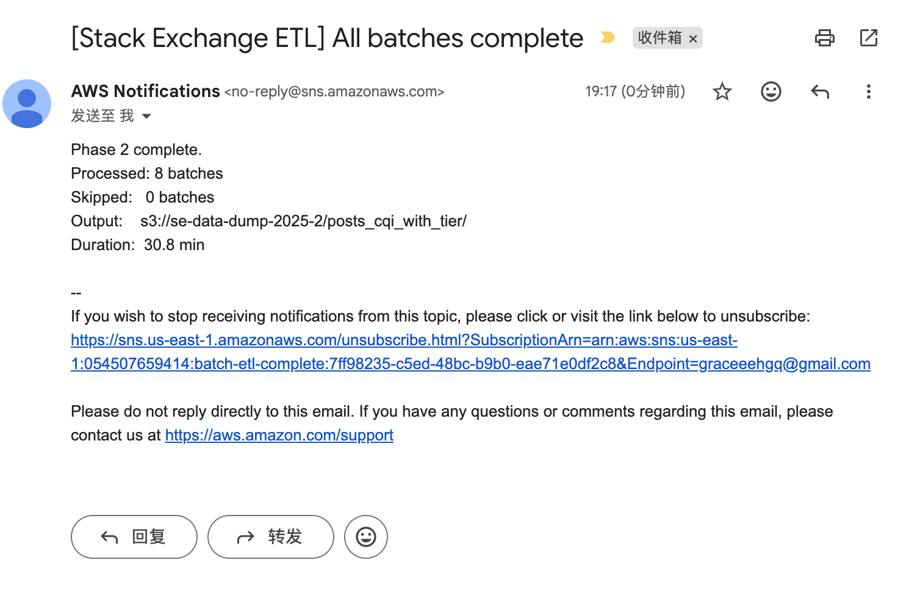

### EDA: Volume Collapse and Quality Shift

Monthly Python question volume on Stack Overflow peaked at roughly 87,000 questions per month before falling to fewer than 50,000 by end of 2024, a level not seen since the platform's early years. The drop accelerated sharply after November 2022. Despite this volume collapse, mean CQI trended upward in the same period, which initially appears consistent with the quality-improvement hypothesis.

Breaking the data down by experience tier reveals a more complicated picture. Expert users saw their CQI fall from 0.727 to 0.694 after ChatGPT, while novice users saw theirs rise from 0.699 to 0.718. Meanwhile, expert post volume collapsed by 83%, faster than the 76% drop for novices. The aggregate quality signal is therefore partly an artifact of composition: the platform lost its most experienced voices disproportionately fast. Tag-category trends show further heterogeneity, with data science and web categories exhibiting clearer upward CQI trajectories than ml/AI categories.

<table>
<tr>
<td>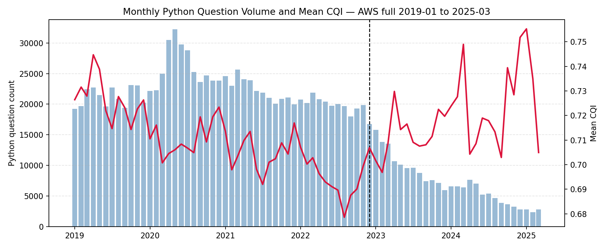 <em>Monthly post volume and mean CQI (2008–2024)</em></td>
<td>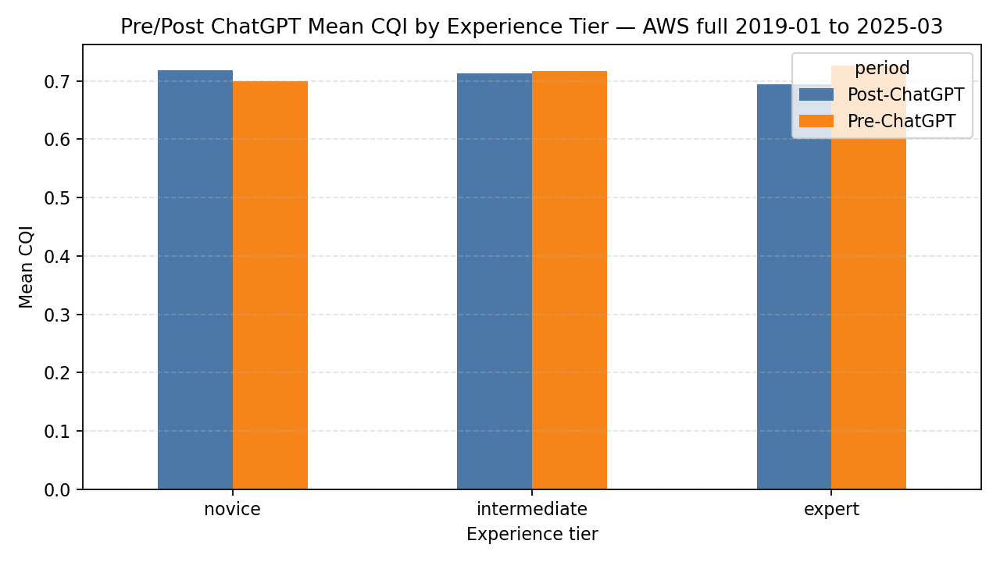 <em>Pre/post ChatGPT CQI by experience tier</em></td>
</tr>
<tr>
<td>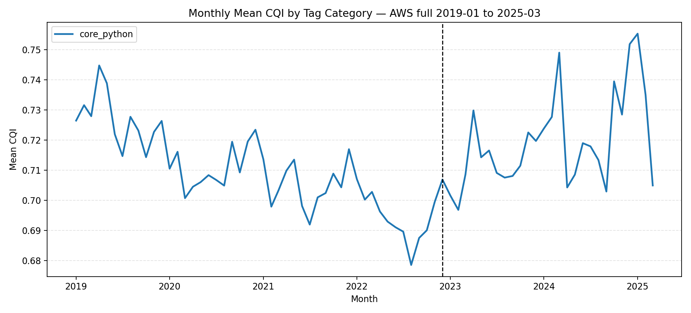 <em>CQI trends by tag category</em></td>
<td>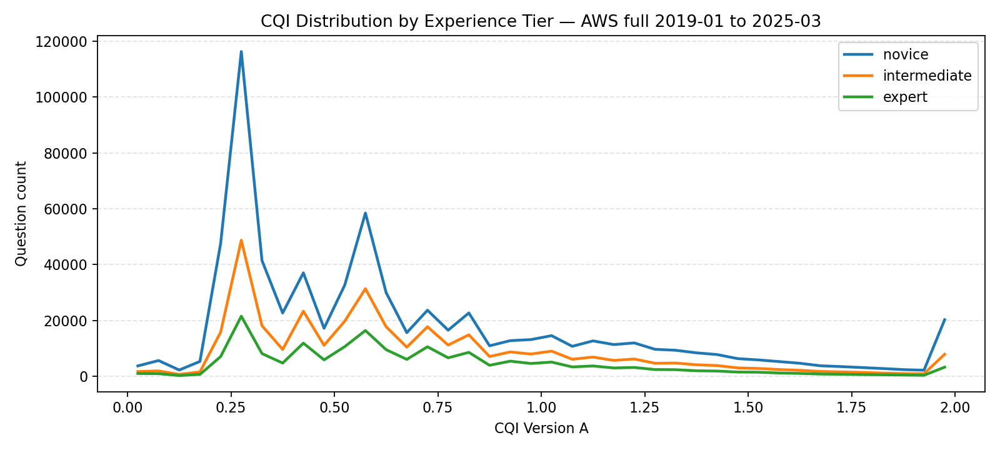 <em>CQI distribution by experience tier</em></td>
</tr>
<tr>
<td>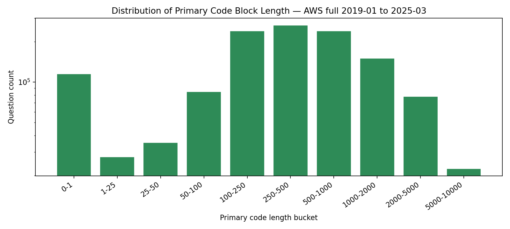 <em>Code length distribution</em></td>
<td>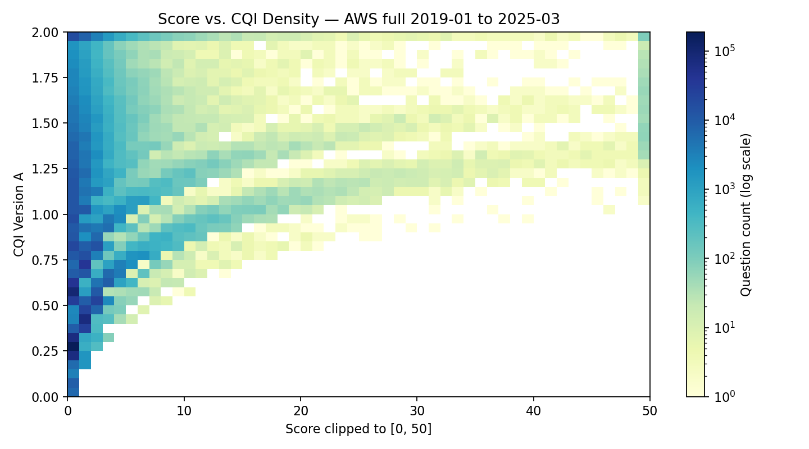 <em>Score vs CQI density</em></td>
</tr>
<tr>
<td>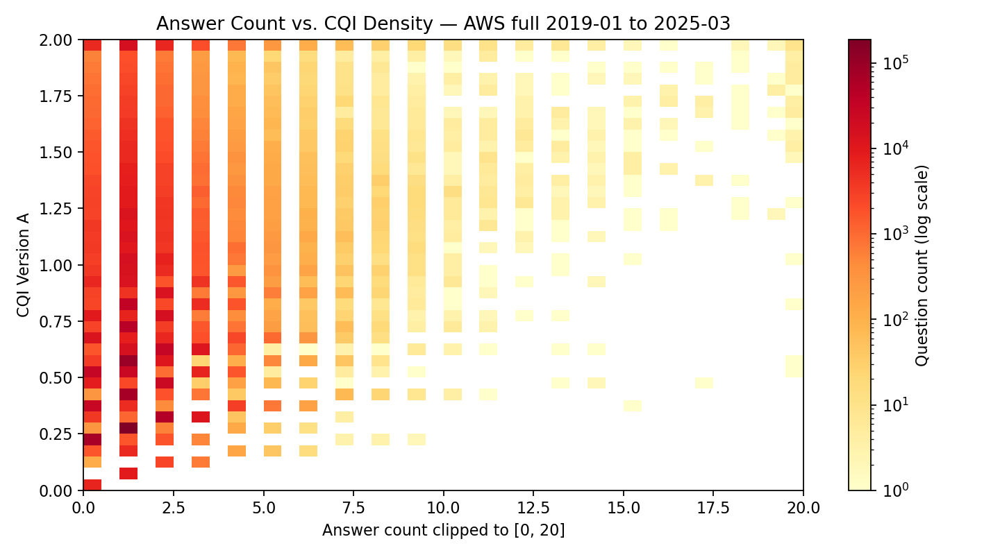 <em>Answer count vs CQI density</em></td>
<td></td>
</tr>
</table>

### RDD, Clustering, and ML Results

**Quality improved in applied domains, though not uniformly.** The RDD estimates show statistically significant CQI increases post-December 2022 in five of fifteen tier-category combinations. The largest effects are concentrated in data science and web categories: intermediate-tier data science posts increased by β = 0.105 (p = 0.002), expert-tier data science by β = 0.095 (p = 0.005), expert-tier web by β = 0.064 (p = 0.039), and intermediate-tier web by β = 0.055 (p = 0.039). The most striking single estimate is novice-tier automation, which increased by β = 0.111 (p = 0.0003), the largest beta in the entire table. These gains are consistent with the quality-improvement hypothesis: AI tools may be helping users in structured, code-heavy domains produce better-formed questions before posting.

**The ml_ai category is the notable exception.** Despite being the domain most adjacent to AI tools, the ml/AI tag category shows no significant post-cutoff CQI change across any experience tier, with point estimates slightly negative for both novice (β = −0.011) and intermediate (β = −0.012) users. This suggests that AI-assisted question writing has not improved the quality of questions in the very domain where users are most likely to be using AI tools, possibly because ML/AI questions tend to be more open-ended and harder to structure, or because these users were already posting high-complexity questions before ChatGPT.

**Expert users' CQI went down.** The pre/post comparison by experience tier reveals a pattern that directly challenges the quality-improvement narrative. Expert users saw a raw CQI decline from 0.727 (pre-ChatGPT) to 0.694 (post-ChatGPT), while novice users showed the opposite: 0.699 before to 0.718 after. Expert post volume collapsed from 157,398 to 26,925, i.e., an 83% drop, while novice volume fell from 560,532 to 132,431, a 76% drop. The platform lost its most experienced users proportionally faster than it lost novices. The aggregate CQI improvements seen in some domain-tier combinations therefore cannot be explained by a simple exit of low-quality novice questions.

<table>
<tr>
<td>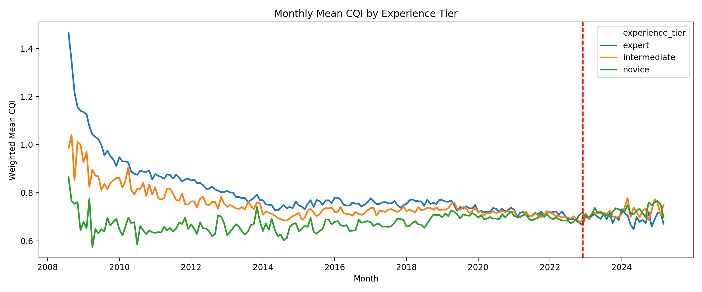 <em>CQI trend by experience tier</em></td>
<td>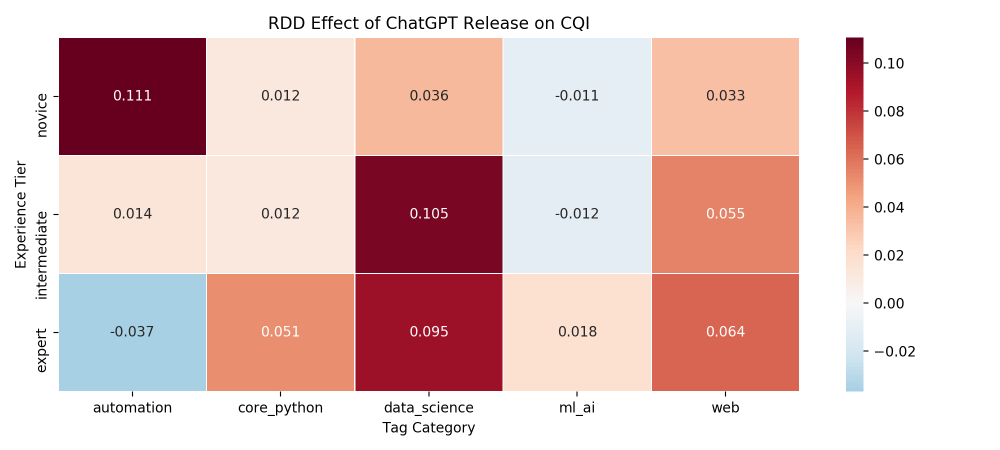 <em>RDD beta heatmap (tier × category)</em></td>
</tr>
<tr>
<td>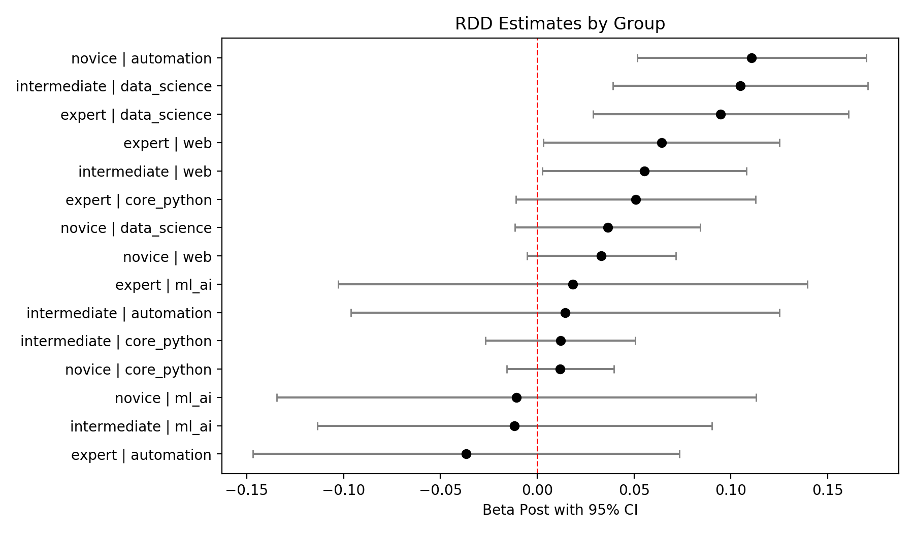 <em>RDD confidence intervals</em></td>
<td>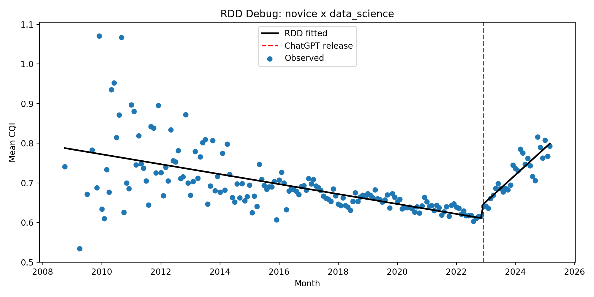 <em>RDD example: novice × data science</em></td>
</tr>
</table>

**Clustering reveals a structural shift toward parseable code.** The KMeans analysis identifies four stable post archetypes. The highest-quality cluster (Cluster 1, n = 290,889) has the highest mean CQI (1.41), a 100% code parseability rate, and the highest post-ChatGPT share in the corpus (19.3%). The lowest-quality cluster (Cluster 3, n = 113,204) contains questions with no code at all, the lowest CQI (0.33), and the lowest acceptance rate (32%). The fact that the fully parseable, high-quality cluster is overrepresented in the post-ChatGPT period suggests AI tools may be raising the floor on code correctness, i.e., users who do post code are posting syntactically cleaner examples than before.

<table>
<tr>
<td>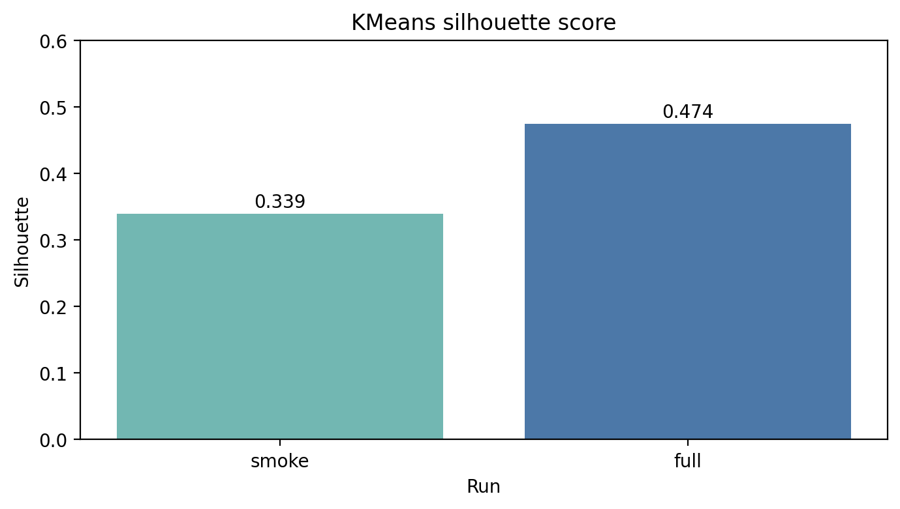 <em>KMeans silhouette score</em></td>
<td>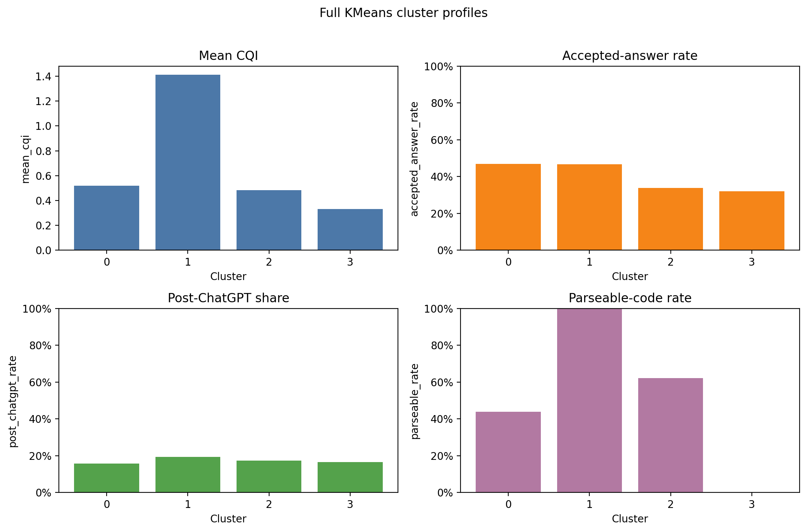 <em>Cluster profiles</em></td>
</tr>
<tr>
<td>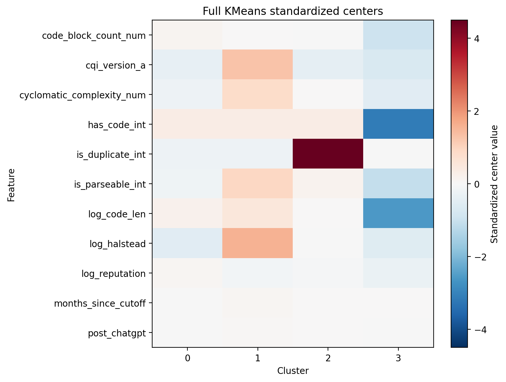 <em>Cluster centers heatmap</em></td>
<td></td>
</tr>
</table>

**The supervised ML model confirms CQI signal is real.** A logistic regression trained on CQI and metadata features to predict accepted-answer status achieves AUC = 0.688 on 247,327 held-out posts, confirming that these code quality signals carry genuine predictive information about community-resolution outcomes, confirming they are not merely noise.

<table>
<tr>
<td>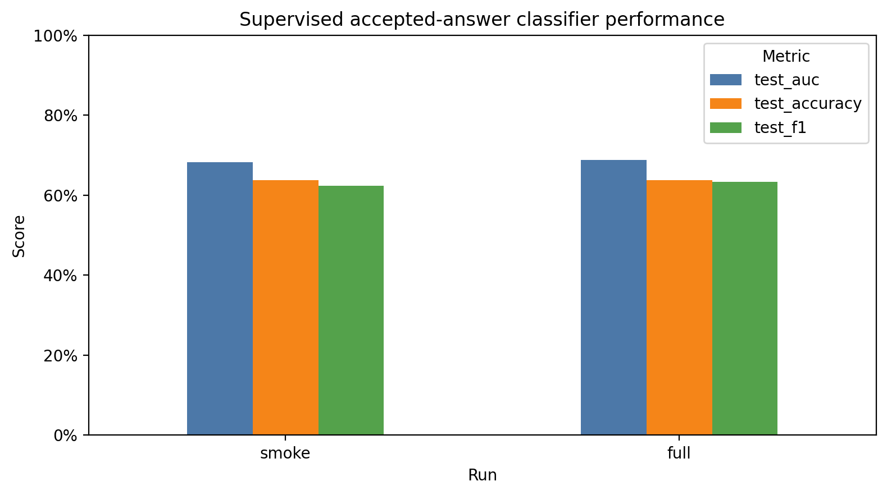 <em>Supervised ML metrics: smoke vs full run</em></td>
<td>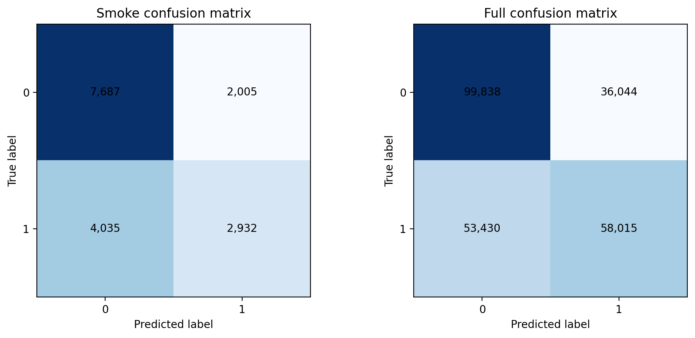 <em>Confusion matrices</em></td>
</tr>
<tr>
<td>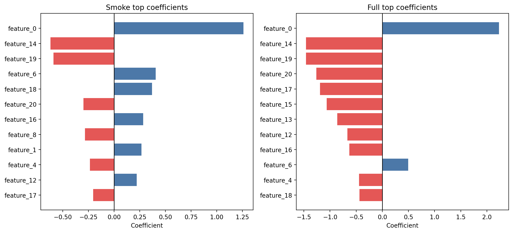 <em>Top predictive coefficients</em></td>
<td></td>
</tr>
</table>

**Synthesis.** Neither hypothesis fully holds, and the truth is more nuanced than either predicts. In applied, code-heavy domains, i.e., data science, web, and automation, question quality rose meaningfully after ChatGPT's release, suggesting that AI tools are genuinely helping users formulate better-structured questions before posting. The platform is not simply shrinking; in these domains it is concentrating around higher-quality contributions. The divergence across domains and experience tiers points toward a transitional period in which AI and community knowledge-sharing are finding a new equilibrium, one where Stack Overflow increasingly serves as a venue for questions that benefit from human expertise rather than those that can be answered by a language model alone.
